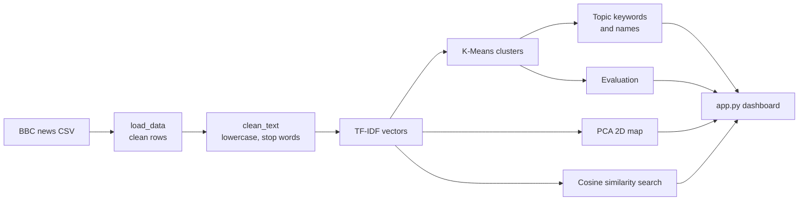

# News Intelligence & Topic Discovery System

An NLP project that **automatically discovers topics in news articles**. It groups related articles, finds the keywords of each topic, draws the clusters on a map, and finds articles similar to a chosen article or to text you type. It runs on an ordinary laptop: no GPU, no paid API, no deep learning.

> The clustering is **unsupervised**. The category labels in the dataset are never used to train the model or to name topics. They are used only afterwards, as an optional check.

---

## Problem statement
Thousands of news articles are published every day. Sorting them into topics by hand is slow, and the topics change over time. This project reads raw article text and discovers the main topics by itself, then lets a user explore the topics and find related stories.

## Objectives
1. Load and clean a real news dataset (missing values, duplicates, noise).
2. Convert text into numbers with TF-IDF.
3. Group articles into topics with K-Means.
4. Extract keywords and a readable name for every topic (the name can be edited).
5. Visualise the clusters in 2D with PCA.
6. Find the 5 most similar articles using cosine similarity.
7. Evaluate the result honestly and show it in a Streamlit dashboard.

## Features
| Page | What you can do |
|---|---|
| **Overview** | See articles processed, topics found, duplicates removed, silhouette score, and the workflow |
| **Topic Explorer** | See every topic with its size and keywords, rename a topic, read representative headlines, browse its articles |
| **Topic Visualization** | Interactive PCA map, filter by topic, article title on hover |
| **Similar News Search** | Pick an existing article or paste new text and get the top 5 similar articles with scores |
| **Model Evaluation** | Silhouette, ARI, NMI, cluster-size chart, comparison of k = 5, 6, 8, 10, limitations |

A slider in the sidebar changes the number of topics (2 to 10).

## Technology stack
Python 3.10+ | Pandas, NumPy | scikit-learn (TF-IDF, K-Means, PCA, cosine similarity, silhouette) | Plotly | Streamlit | Pytest | Git/GitHub | VS Code

## Project structure
```
news-topic-project/
├── requirements.txt      libraries to install
├── download_data.py      downloads the BBC dataset into data/
├── pipeline.py           all machine-learning code (no Streamlit)
├── app.py                the Streamlit dashboard
├── test_pipeline.py      automated tests
└── data/                 created by download_data.py (not committed to Git)
```

## System architecture


## Dataset
**BBC News full-text dataset**: 2,225 articles (2004-2005) from five areas: business, entertainment, politics, sport, tech.

* Original source: D. Greene and P. Cunningham (2006), *Practical Solutions to the Problem of Diagonal Dominance in Kernel Document Clustering*, ICML. Dataset page: http://mlg.ucd.ie/datasets/bbc.html
* CSV copy used here: GitHub mirror `suraj-deshmukh/BBC-Dataset-News-Classification`.
* Columns: `news` (the title is the first line, followed by the article text) and `type` (category).
* The dataset is published for non-commercial and research use and the articles are copyrighted by the BBC. **Check the terms on the dataset page and cite the paper in your report.**
* The file is **not** stored in Git. Download it with `python download_data.py`.

Facts found while preparing the data (measured):
* The file mixes UTF-8 with a few other bytes (the pound sign), so it is decoded with `errors="replace"`.
* 98 exact duplicates are removed: **2,225 -> 2,127 articles**.

## Machine-learning workflow

| Step | What happens | Why |
|---|---|---|
| 1. Load | Read the CSV, check the `news` column exists, drop empty rows and duplicates, split title and text | Bad input should give a clear error |
| 2. Clean | Lowercase, remove HTML and punctuation, remove stop words and plain numbers | Removes noise. Names and abbreviations (`uk`, `ipod`) are kept. No stemming, so keywords stay readable |
| 3. TF-IDF | `max_features=5000`, `min_df=2`, `max_df=0.85`, `ngram_range=(1,2)`, `sublinear_tf=True` | Limits memory, ignores typos and over-common words, captures phrases like "prime minister" |
| 4. K-Means | `k=5` by default, `random_state=42`, `n_init=10`, run on the TF-IDF vectors | Same result every run. PCA is **not** used for clustering |
| 5. Keywords | Score = average TF-IDF in the cluster minus average TF-IDF over all articles; top 8 | Shows words that are *distinctive* for the topic |
| 6. Topic names | First 3 keywords that do not look alike, e.g. `Film / Awards / Best` | Readable names without using the dataset labels |
| 7. PCA | 2 components, plotted with Plotly | An approximate picture of thousands of dimensions |
| 8. Search | Clean the text, `vectorizer.transform`, cosine similarity, top 5, selected article excluded | The model is **never retrained** for a search |

**Unsupervised vs supervised:** a classifier learns from labelled examples and is judged by accuracy. Clustering gets no labels; it only groups similar articles. So this project does **not** report "accuracy".

## Installation and run 

```powershell
# 1. create and activate a virtual environment
python -m venv .venv
.\.venv\Scripts\Activate.ps1
#    if PowerShell blocks scripts, run once:
#    Set-ExecutionPolicy -Scope Process -ExecutionPolicy Bypass

# 2. install the libraries
pip install -r requirements.txt

# 3. download the dataset (saved as data\bbc_news.csv)
python download_data.py

# 4. run the automated tests
python -m pytest

# 5. start the dashboard, then open http://localhost:8501
streamlit run app.py
```

Linux / macOS: activate with `source .venv/bin/activate`.

* The first page load trains the model (a few seconds). After that it is cached, so clicking around is instant.
* If Streamlit asks for an email in the terminal, press Enter.
* Stop the app with `Ctrl + C`.

## Evaluation methodology
* **Silhouette score** (cosine distance): how well separated the clusters are, from -1 to 1. Low values are normal for sparse, high-dimensional text.
* **Cluster-size chart**: shows if one cluster is huge or tiny.
* **Keywords and headlines**: the real test of whether a topic makes sense to a human. Always read them.
* **Comparison of k = 5, 6, 8, 10**: the highest silhouette is not automatically the best choice.
* **ARI and NMI**: compare clusters with the dataset's own five categories. Used only as an after-training check, never for training.
* **Search check (manual)**: for several articles, read the top 5 results and count how many are really related.

## Automated tests
`python -m pytest` runs 5 tests on a tiny fake dataset: text cleaning, every article gets a cluster, invalid `k` is rejected, search excludes the selected article and returns 5 sorted results, and empty search text is rejected.

##  Results and limitations

### Measured results (k = 5, seed 42)
Run with Python 3.12 and scikit-learn 1.8. Your last decimals may differ slightly on other setups, so **use the numbers from your own run in your report**.

| Metric | Value |
|---|---|
| Articles after cleaning | 2,127 (98 duplicates removed) |
| Silhouette (cosine) | 0.0324 |
| Adjusted Rand Index (vs 5 BBC categories) | 0.9224 |
| Normalized Mutual Information | 0.8909 |
| Variance kept by the 2 PCA axes | 2.4% |

| k | Silhouette |
|---|---|
| 5 | 0.0324 |
| 6 | 0.0323 |
| 8 | 0.0342 |
| 10 | 0.0361 |

Topics found at k = 5: *Labour / Election / Blair* (407 articles), *Game / Win / Cup* (505), *Growth / Shares / Company* (495), *Film / Awards / Best* (373), *Users / Technology / Software* (347).

**Interpretation:** the silhouette is low in absolute terms and almost the same for every k, so it cannot choose k by itself. Larger k values score slightly higher but split the data into finer topics that agree less with the five broad BBC categories. We keep k = 5 as the default because the topics are easy to interpret.

### Limitations
* TF-IDF ignores word meaning and order, so synonyms count as different words.
* K-Means needs k in advance and puts every article into exactly one cluster, so stories that sit between topics (for example a football-club takeover) are forced into one.
* The 2D PCA map keeps only about 2.4% of the information, so clusters overlap on the picture even though they are separable in the full space.
* The dataset is from 2004-2005 and has only five broad areas.
* Topic names are automatic summaries of keywords and may need renaming.
* Silhouette, ARI and NMI do not prove that topics are useful to people; read the keywords and articles too.

## Troubleshooting
| Problem | Fix |
|---|---|
| `python` is not recognised | Reinstall Python and tick "Add Python to PATH", then reopen VS Code |
| `ModuleNotFoundError` | Activate the virtual environment, then `pip install -r requirements.txt` |
| "Dataset not found" in the app | Run `python download_data.py` |
| Download fails (network) | Download the BBC CSV manually and save it as `data/bbc_news.csv` |
| Port already in use | `streamlit run app.py --server.port 8502` |


## Future enhancements
* Compare with LDA, NMF or sentence embeddings.
* Choose k automatically (silhouette plus topic coherence).
* Save the trained model to disk and add a command-line build step.
* Let users upload their own CSV.
* Use a larger and more recent dataset; analyse topics over time.
* Deploy on Streamlit Community Cloud.
